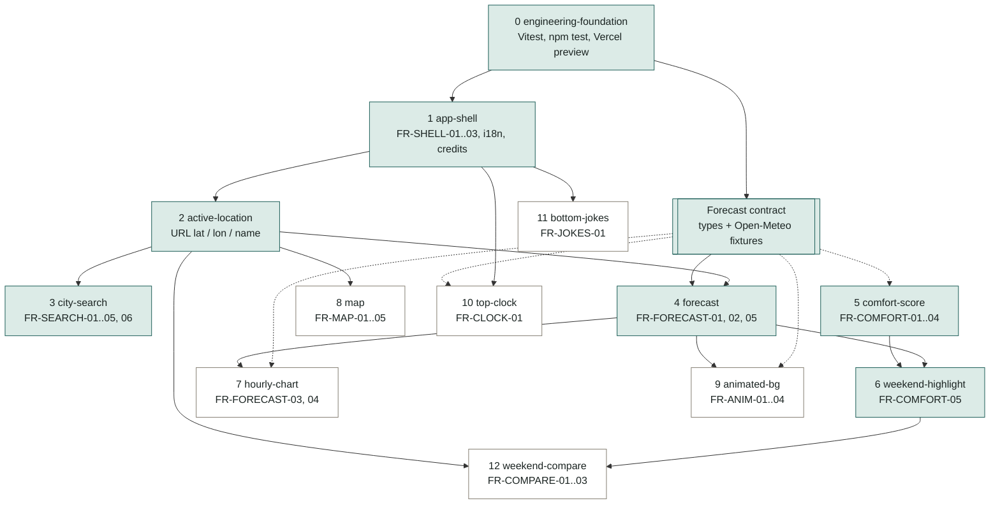

# Capabilities — Weather Explorer

> **Status: agreed (2026-11-23).** Analysis of `docs/requirements.md` (PRD, updated 2026-11-23) and `docs/product-brief.md`, checked against `DESIGN.md`, `docs/design-system/` and the code already in the repo.
> **2026-11-23:** the contradictions in §6 were fixed, and all 16 decisions (D1–D16) are resolved — see [implementation-roadmap.md](implementation-roadmap.md#decisions) and the PRD change log. The missing requirements in §5 are now PRD rows.
> Next step after sign-off: one OpenSpec change per roadmap slice. The first, `setup-engineering-foundation`, is shipped and archived (`openspec/changes/archive/`); its `quality-gates` spec now lives in `openspec/specs/`. Next: `weather-core`.

## 1. Capability map

Twelve capabilities. Ten carry the PRD's capability names. Two are proposed splits that make sequencing possible: `active-location` and `weekend-highlight`. `hourly-chart` splits out of `forecast`, and `engineering-foundation` holds the cross-cutting tooling.

| # | Capability (spec id) | Requirements | In PRD as | Hard dependencies | Can start |
| --- | --- | --- | --- | --- | --- |
| 0 | `engineering-foundation` | NFR-DX-01, NFR-DX-02, NFR-DX-03, TC-STACK-05, TC-DEPLOY-01, TC-PURE-01, TC-RUNTIME-01, BC-DEMO-01 | cross-cutting | — | now |
| 1 | `app-shell` | FR-SHELL-01 … 04, BC-BRAND-03, NFR-I18N-01, BC-BRAND-01, BC-BRAND-02, BC-PRIVACY-03 | implicit | 0 | now |
| 2 | `active-location` | FR-SEARCH-03 (URL part), FR-LOC-01, FR-LOC-02; consumed by FR-MAP-03, FR-COMPARE-03, FR-SEARCH-06 | **new split** | 1 | after 1 |
| 3 | `city-search` | FR-SEARCH-01, 02, 04, 05, 06, 07; BC-PRIVACY-02; TC-DATA-01; TC-STACK-03; TC-GEO-01 (naming a geolocation) | `city-search` | 2 | after 2 |
| 4 | `forecast` | FR-FORECAST-01, 02, 05, 06, 07, 08; NFR-API-01; TC-DATA-01; TC-STACK-03; NFR-COST-01 | `forecast` | 2, **Forecast contract** | after 2 |
| 5 | `comfort-score` | FR-COMFORT-01, 02, 03, 04, 07; TC-PURE-01 | `comfort-score` | **Forecast contract** only | **now — fully parallel** |
| 6 | `weekend-highlight` | FR-COMFORT-05, 06, 08 | **new split** (from `comfort-score`) | 4, 5 | after 4 + 5 |
| 7 | `hourly-chart` | FR-FORECAST-03, FR-FORECAST-04 | **split** (from `forecast`) | 4 | after 4 |
| 8 | `map` | FR-MAP-01 … 05; TC-STACK-04; TC-MAP-01; TC-GEO-01 | `map` | 2 | after 2 |
| 9 | `animated-bg` | FR-ANIM-01 … 04 | `animated-bg` | 4 (current condition, sunrise/sunset) | contract → now; wiring after 4 |
| 10 | `top-clock` | FR-CLOCK-01, 02 | `top-clock` | 1; place time zone from 4 | after 1 |
| 11 | `bottom-jokes` | FR-JOKES-01, 02 | `bottom-jokes` | 1 | after 1 |
| 12 | `weekend-compare` | FR-COMPARE-01 … 04 | `weekend-compare` (MVP) | 2, 4, 5, 6 | last |

**Already built** (from the design-system integration): tokens and themes, `Button`, `ComfortBadge`, `Notice`, `DayCard`, `WeekendHighlight`, `CompareTable`, comfort *levels* (`lib/comfort.ts`), place-local date formatting (`lib/format.ts`), centralised strings (`lib/strings.ts`). The remaining work is mostly data, state and behaviour, not visual design.

## 2. Capabilities in detail

### 0 · `engineering-foundation`
- **Purpose:** make every later change verifiable and demonstrable.
- **Scope:** Vitest and an `npm test` script (none exist yet). `npm run verify` under 60 s (NFR-DX-01), run by CI on every PR (NFR-DX-02), with a Fallow gate (NFR-DX-03). Node 24 pinned (TC-RUNTIME-01). A Vercel project with a preview URL per PR (TC-DEPLOY-01). OpenSpec change: `setup-engineering-foundation`.
- **Not here:** Open-Meteo fixtures belong to `define-forecast-contract` (they need its types). NFR-OBS-01 (console silence) is checked by every UI change on its preview and audited in M5; the foundation only adds the preview where it's checked.
- **Provides:** the test runner, the `verify` command, the CI check and the preview URL that every other capability verifies against.

### 1 · `app-shell`
- **Purpose:** the frame every feature mounts into.
- **Scope:** a header with the product name and a theme indicator (FR-SHELL-01). A responsive layout with named slots for search, weekend, days, chart, map, compare and footer (FR-SHELL-02). The first-load hero with centred search and no default city (FR-SHELL-03). A footer with linked Open-Meteo and OSM credits (BC-BRAND-02). Moving strings to `lib/i18n/uk.ts` plus `en.ts` (NFR-I18N-01: type-checked `en.ts`, locale fixed to `uk`).
- **Provides:** layout slots. Pre-defining them avoids merge conflicts in `app/page.tsx` when the M3 features are built in parallel.

### 2 · `active-location` *(proposed split)*
- **Purpose:** one source of truth for "which place": the URL `?lat=&lon=&name=` (FR-SEARCH-03).
- **Scope:** parse and validate the params (range, precision, missing name). Write the URL, choosing push or replace for history. Render the empty state when there are no params. Handle invalid params calmly (missing requirement, §5).
- **Writers:** city-search, the geolocation button, map click, and "make active" in compare. **Readers:** forecast, map, compare.
- **Why split:** four features write to it and three read it. Specifying it once keeps the URL contract from being reinvented in each feature.

### 3 · `city-search`
- **Scope:** a debounced combobox with suggestions from Open-Meteo `/v1/search` through a server route (TC-DATA-01). Rows show name, admin1, country and an optional flag. Selecting a row writes to `active-location`. Enter on a lone suggestion selects it. Zero results show an inline `Notice`. The opt-in «Використати моє місцезнаходження» button (FR-SEARCH-06, BC-PRIVACY-02) gets its place name the same way as a map click: Nominatim reverse lookup with a coordinates fallback (TC-GEO-01).
- **Design system:** CitySearch is specified (≈250 ms debounce, about 8 rows, arrow/Enter/Esc) but not ported yet.

### 4 · `forecast`
- **Scope:** fetch on the server from Open-Meteo (`timezone=auto`) when a location is active (FR-FORECAST-01). Normalise into a framework-free **Forecast domain model** (`lib/`, TC-PURE-01). Render 7 `DayCard`s (FR-FORECAST-02). Re-fetch when the location changes with server caches per rounded location, keeping the old forecast visible while loading (FR-FORECAST-05). Calm loading and error states (FR-FORECAST-06, 07). Fetch 8 days so a Sunday visitor's next weekend is covered (FR-FORECAST-01).
- **Forecast contract:** the normalised types and fixtures for daily, hourly, current, sunrise/sunset and timezone. **Define this first.** It unblocks comfort-score, hourly-chart, animated-bg and compare to proceed in parallel against fixtures.
- **Icons:** `lucide-react`, 12 glyphs mapped from WMO codes (FR-FORECAST-08, PRD Appendix B).

### 5 · `comfort-score`
- **Scope:** a pure, total function `comfortScore(daily) → { value 0–100, rationale }` in `lib/scoring/comfort.ts` (FR-COMFORT-01). Inputs are feels-like temperature, precipitation probability, wind, cloud cover and UV (FR-COMFORT-02). The rationale is one Ukrainian sentence of at most 80 characters with no emoji (FR-COMFORT-03). The per-day badge reuses `ComfortBadge` (FR-COMFORT-04).
- **Independence:** this is the most self-contained capability, needing only the input type. Build it test-first with a table of named weather cases.
- **Model:** capped penalties for cold, heat, rain, wind, cloud and UV, a templated rationale and 10 reference cases (FR-COMFORT-07, PRD Appendix A). Cloud cover is the 09:00–18:00 mean of hourly data (FR-COMFORT-02).

### 6 · `weekend-highlight` *(proposed split)*
- **Scope:** the weekend score is the Saturday and Sunday average by the place's local dates (FR-COMFORT-05). It's shown in `WeekendHighlight` above the day cards with a verdict title and the rationale.
- **Why split:** it needs both the data and the score, plus the weekend rule: Monday–Saturday → this weekend, Sunday → next weekend (FR-COMFORT-06). The verdict follows the band (FR-COMFORT-08). Compare reuses the same aggregation.

### 7 · `hourly-chart` *(split from forecast)*
- **Scope:** a 48-hour temperature line in Recharts (FR-FORECAST-03), with today's sunrise and sunset beneath it (FR-FORECAST-04), in the place's time zone.
- **Why split:** it's a heavy client dependency with its own performance budget (NFR-PERF-03, risk R2). It can be built against fixtures once the contract exists.

### 8 · `map`
- **Scope:** Leaflet and react-leaflet, client-only, with a skeleton of the same size during SSR (FR-MAP-01, FR-MAP-05). A marker and a popup with the city name (FR-MAP-02). OSM attribution (FR-MAP-04, TC-MAP-01). A click sets the active location (FR-MAP-03).
- **Naming a clicked point:** Open-Meteo has no reverse geocoding, so FR-MAP-03 uses OSM Nominatim through a server route with a coordinates fallback (TC-GEO-01). Its usage policy allows at most 1 request/s app-wide, needs an identifying User-Agent and caching, and the feature must be switchable off without a code change. FR-MAP-01, 02, 04 and 05 don't depend on it.

### 9 · `animated-bg`
- **Scope:** the sky gradient for day, night or overcast, with cloud, rain and snow particles (FR-ANIM-01). Day or night follows the place's sunrise and sunset, not the visitor's clock (FR-ANIM-02). Reduced motion gets a static gradient (FR-ANIM-03), and the layer has `pointer-events: none` (FR-ANIM-04). The design system already defines the `sky-*` tokens and motion limits.
- **Needs:** current condition, `is_day` or sunrise/sunset, and the place's current time, all from the Forecast contract.

### 10 · `top-clock`
- **Scope:** a compact, accessible live clock in the header (FR-CLOCK-01), using the mono `clock` type.
- **Rule:** the place's time with an active location, else the visitor's; `HH:mm`, updated each minute, rendered client-side in a fixed-width slot (FR-CLOCK-02, risk R4).

### 11 · `bottom-jokes`
- **Scope:** deterministic Ukrainian weather jokes in the footer, with no external API (FR-JOKES-01).
- **Rule:** 14 jokes in the Ukrainian strings, chosen by `dayOfYear mod 14` of the place-local date (FR-JOKES-02).

### 12 · `weekend-compare`
- **Scope:** pin up to 3 cities as chips (FR-COMPARE-01). A toggle switches to a weekend comparison table (FR-COMPARE-02). Each city gets a "make active" control (FR-COMPARE-03).
- **Layout:** one row per city, sorted best first, row activation makes it active — the specified `CompareTable`. MVP scope (promoted at Checkpoint 1). Pins live only in the URL as repeated `pin=` params (FR-COMPARE-04).
- **Needs:** fetching up to 4 locations at once (the active one plus 3 pins), the comfort score and the weekend rule.

## 3. Dependency graph

Solid arrows are hard dependencies (code must exist). Dashed arrows depend only on a contract (types and fixtures), so work can run in parallel.

Teal: the smallest end-to-end system (milestones M0–M2). White: features added on top of it.

## 4. What can run independently or in parallel

| When | Independent work items | Shared touch points to coordinate |
| --- | --- | --- |
| Right away | `engineering-foundation`; `comfort-score` (pure, test-first); the Forecast contract | Comfort-score input type ⇄ Forecast contract: agree on it first, in one short change |
| After `app-shell` | `top-clock`, `bottom-jokes` (header/footer slots only) | `lib/i18n/uk.ts` (append-only keys) |
| After `forecast` + contract | `hourly-chart`, `animated-bg`, `map` (FR-MAP-01/02/04/05), city-search polish (keyboard, geolocation) | `app/page.tsx` slots; Open-Meteo request fields (add all fields in M2 so tracks don't each extend the fetch) |
| Last | `weekend-compare` | Reuses the weekend aggregation and comfort score; multi-location fetch |

Truly independent of everything except the contract: **comfort-score**, plus **animated-bg** and **hourly-chart** when built against fixtures.
Strictly sequential: foundation → shell → active-location → forecast → weekend-highlight. This is the critical path to a working product.

## 5. Missing requirements — added to the PRD 2026-11-23

| Gap | Added as |
| --- | --- |
| "Use my location" button | FR-SEARCH-06 |
| Geolocation denied / unavailable / slow | FR-SEARCH-07 |
| Forecast failure or timeout | FR-FORECAST-06 |
| Loading state | FR-FORECAST-07 |
| Weather icon per WMO code | FR-FORECAST-08, TC-STACK-06, Appendix B |
| Invalid or partial URL params; URL precision | FR-LOC-01, Appendix C |
| Back/forward history | FR-LOC-02 |
| Which weekend is "upcoming" | FR-COMFORT-06 |
| Scoring weights and reference cases | FR-COMFORT-07, Appendix A |
| Weekend verdict wording | FR-COMFORT-08 |
| Where pins live | FR-COMPARE-04, Appendix C |
| Open-Meteo usage limits and terms | NFR-API-01 |
| Theme: indicator vs toggle | FR-SHELL-04 |
| Whose time the clock shows | FR-CLOCK-02 |
| Joke source and rotation | FR-JOKES-02 |
| Units and formats | BC-BRAND-03 |

## 6. Contradictions — resolved 2026-11-23

All fixed in the documents; see the change log at the end of `docs/requirements.md`.

| Item | Was | Now | Fixed in |
| --- | --- | --- | --- |
| FR-SHELL-02 | 768 / 1280 px; 1 / 2 / 3 columns | 720 / 1024 px; 1 column → 12-column grid, max 1200 px (D2) | PRD |
| FR-SHELL-01 | "logo" | Product name in `heading` type, no logo | PRD |
| FR-COMFORT-04 | green / yellow / red | good / fair / poor fills, number + word | PRD, brief |
| FR-COMPARE-02/03 | Cities as columns, sticky headers | One row per city, best first, row activation makes it active (D3) | PRD |
| FR-MAP-03 | Reverse geocode "via Open-Meteo" (no such API) | OSM Nominatim via a server route + coordinates fallback; new TC-GEO-01 (D1) | PRD |
| TC-STACK-01 | Next.js 16.2, React 19.2 | 16.4.x / 19.3.x (installed) | PRD |
| TC-STACK-02 | PostCSS plugin; shadcn/ui; cva | `@tailwindcss/turbopack`; design-system components; no shadcn (D9) | PRD |
| weekend-compare status | "optional" | MVP (promoted at Checkpoint 1) | PRD |
| FR-SEARCH-05 | "Nothing found" | «Нічого не знайдено» | PRD, brief |
| FR-SEARCH-06 | Cited by the brief, missing from the PRD | Added | PRD |
| FR-COMFORT-03 | One sentence ≤ 80 chars, but the design-system sample is two sentences | PRD rule wins; recorded in DESIGN.md; preview sample fixed | DESIGN.md, `/design-system` |

**Not a contradiction — implementation pending:** NFR-I18N-01 puts strings in `lib/i18n/uk.ts` + `en.ts`, while the code still has `lib/strings.ts`. The move is scheduled in M0 (`add-app-shell`). DESIGN.md and AGENTS.md describe the code as it is today and will follow the move.

## 7. Requirement coverage

Every PRD ID mapped to the capability that owns it (✱ = cross-cutting, verified in every milestone).

| Requirement | Owner | | Requirement | Owner |
| --- | --- | --- | --- | --- |
| FR-SHELL-01 | app-shell | | NFR-PERF-01 | foundation (gate), forecast (streaming) ✱ |
| FR-SHELL-02 | app-shell | | NFR-PERF-02 | foundation (gate) ✱ |
| FR-SHELL-03 | app-shell | | NFR-PERF-03 | foundation (budget); map, hourly-chart, animated-bg ✱ |
| FR-CLOCK-01 | top-clock | | NFR-A11Y-01 | every UI capability ✱ |
| FR-SEARCH-01 | city-search | | NFR-A11Y-02 | design system (done); verify per milestone ✱ |
| FR-SEARCH-02 | city-search | | NFR-COST-01 | forecast, city-search, map ✱ |
| FR-SEARCH-03 | active-location (+ city-search writes) | | NFR-OBS-01 | every UI capability (preview check); M5 audit ✱ |
| FR-SEARCH-04 | city-search | | NFR-DX-01, 02, 03 | foundation |
| FR-SEARCH-05 | city-search | | NFR-I18N-01 | app-shell |
| FR-SEARCH-06 | city-search | | TC-GEO-01 | map, city-search |
| FR-JOKES-01 | bottom-jokes | | TC-STACK-01, 02 | foundation |
| FR-FORECAST-01 | forecast | | TC-STACK-03 | forecast, city-search, map |
| FR-FORECAST-02 | forecast | | TC-STACK-04 | map |
| FR-FORECAST-03 | hourly-chart | | TC-STACK-05 | foundation |
| FR-FORECAST-04 | hourly-chart | | TC-DEPLOY-01, TC-RUNTIME-01 | foundation |
| FR-FORECAST-05 | forecast | | TC-DATA-01 | forecast, city-search, map |
| FR-MAP-01 | map | | TC-MAP-01 | map |
| FR-MAP-02 | map | | TC-PURE-01 | foundation (lint rule), comfort-score, forecast model ✱ |
| FR-MAP-03 | map (+ active-location), TC-GEO-01 | | BC-PRIVACY-01 | ✱ (no analytics; verified via network log) |
| FR-MAP-04 | map | | BC-PRIVACY-02 | city-search (FR-SEARCH-06) |
| FR-MAP-05 | map | | BC-PRIVACY-03 | app-shell ✱ (no cookies; pins in the URL) |
| FR-COMFORT-01 | comfort-score | | BC-BRAND-01 | design system (done) ✱ |
| FR-COMFORT-02 | comfort-score | | BC-BRAND-02 | app-shell |
| FR-COMFORT-03 | comfort-score | | BC-DEMO-01 | foundation (preview URL), every milestone ✱ |
| FR-COMFORT-04 | comfort-score | | | |
| FR-COMFORT-05 | weekend-highlight | | | |
| FR-ANIM-01 … 04 | animated-bg | | | |
| FR-COMPARE-01 … 03 | weekend-compare | | | |

Added with the 2026-11-23 decisions:

| Requirement | Owner |
| --- | --- |
| FR-SHELL-04 | app-shell |
| FR-CLOCK-02 | top-clock |
| FR-SEARCH-07 | city-search |
| FR-LOC-01, FR-LOC-02 | active-location |
| FR-FORECAST-06, 07, 08 | forecast |
| FR-COMFORT-06, 08 | weekend-highlight |
| FR-COMFORT-07, FR-COMFORT-09 | comfort-score (weekend part: weekend-highlight) |
| FR-COMPARE-04, FR-COMPARE-05 | weekend-compare |
| FR-JOKES-02 | bottom-jokes |
| NFR-API-01 | forecast, city-search ✱ |
| TC-STACK-06 | forecast (icons) |
| BC-BRAND-03 | every UI capability ✱ |
