# Implementation roadmap — Weather Explorer

> **Status: agreed (2026-11-23).** Built on [capabilities.md](capabilities.md). **All 16 decisions are resolved** (demo-scale choices; see [Decisions](#decisions) and the PRD change log). Nothing blocks M0.
> Each slice below is meant to become **one OpenSpec change** (spec → tasks → implement → verify → archive). Created so far: `setup-engineering-foundation` (M0 foundation).

## Principles

1. **Smallest end-to-end system first.** Search a place, see its 7 days, get the weekend answer, all deployed. Everything else layers on top.
2. **Contracts before parallelism.** The Forecast domain types and fixtures come first, so the comfort score, chart, sky and compare can be built separately against fixtures.
3. **Every milestone ends deployed and demonstrable** on a Vercel preview (BC-DEMO-01, TC-DEPLOY-01). It must pass `lint && tsc && test && build`, Fallow, a console-silence check and a visual check in both themes at 390 px and 1280 px.
4. **Maker ≠ checker.** Each change is reviewed against its spec scenarios by a separate pass (a reviewer agent and CodeRabbit), not by the agent that wrote it.
5. **The PRD stays the source of truth.** Accepted decisions are written back into `requirements.md` before the change that depends on them starts.

## Roadmap at a glance

```mermaid
flowchart LR
  subgraph M0["M0 Foundation and contracts"]
    direction TB
    A0["engineering-foundation<br/>Vitest, npm test, Vercel"]
    A1["app-shell<br/>layout slots, i18n move, credits"]
    A2[["Forecast contract<br/>types + fixtures"]]
  end
  subgraph M1["M1 Walking skeleton"]
    direction TB
    B1["active-location<br/>URL state"]
    B2["forecast<br/>server fetch + 7 DayCards"]
    B3["city-search, basic<br/>suggest + select + empty"]
  end
  subgraph TA["Track A, parallel from M0"]
    C1["comfort-score<br/>pure fn, table tests"]
  end
  subgraph M2["M2 The answer = MVP core"]
    direction TB
    D1n["comfort badges in DayCards"]
    D2n["weekend-highlight"]
    D3n["loading + error states"]
  end
  subgraph M3["M3 Parallel feature tracks"]
    direction TB
    E1["3a map"]
    E2["3b hourly-chart"]
    E3["3c animated-bg"]
    E4["3d top-clock"]
    E5["3e bottom-jokes"]
    E6["3f search completion<br/>keyboard, geolocation"]
  end
  subgraph M4["M4 Compare"]
    F1["weekend-compare"]
  end
  subgraph M5["M5 Hardening and demo"]
    G1["perf, a11y, console,<br/>recordings, PRD status"]
  end

  M0 --> M1 --> M2 --> M3 --> M4 --> M5
  A2 -.-> C1
  C1 --> M2
```

**Critical path:** foundation → shell → active-location → forecast → weekend-highlight. Comfort-score runs beside it and has to land before M2.

## Milestones

### M0 · Foundation and contracts
| | |
| --- | --- |
| **Goal** | Every later change can be tested, previewed and built in parallel without collisions. |
| **Capabilities** | `engineering-foundation`, `app-shell` (no features), Forecast contract |
| **Requirements** | NFR-DX-01, TC-STACK-05, TC-DEPLOY-01, TC-PURE-01, FR-SHELL-01, FR-SHELL-02, FR-SHELL-03 (static), NFR-I18N-01, BC-BRAND-02 |
| **Work** | Add Vitest and an `npm test` script. Connect Vercel previews. Move `lib/strings.ts` → `lib/i18n/uk.ts` (+ type-checked `en.ts`, NFR-I18N-01). Header with theme indicator. Footer with linked credits. Page layout with **named empty slots** for every later feature. `lib/forecast/types.ts` plus recorded Open-Meteo fixtures (one normal city, one rainy, one polar-night or extreme, a Sunday edge). A lint rule blocking `next/*`, `react` and DOM imports in `lib/`. |
| **Exit** | Pipeline under 60 s on a clean checkout. Preview URL live. Fixtures parse into the domain types in a unit test. |
| **Decided** | D10 English fallback, D14 URL precision |

### Track A (parallel from M0) · `comfort-score`
| | |
| --- | --- |
| **Goal** | The product's core judgement as a pure, fully tested function. |
| **Requirements** | FR-COMFORT-01, 02, 03, 07 (model and reference cases in PRD Appendix A) |
| **Work** | Test-first: the 10 reference cases in PRD Appendix A, one test each. Property tests that the function always returns a value (output in 0–100 for any input, never throws, rationale at most 80 characters, no `!`, no emoji). |
| **Exit** | Scenarios in the spec match the tests one to one, and coverage of `lib/scoring` is 100%. |
| **Decided** | D6 formula, D13 cloud cover from hourly data |

### M1 · Walking skeleton (smallest end-to-end system)
| | |
| --- | --- |
| **Goal** | On the preview URL: type «Львів», pick it, the URL updates, and 7 day cards from real data appear. Sharing the URL reproduces the view. |
| **Capabilities** | `active-location`, `forecast` (data + DayCards), `city-search` (basic) |
| **Requirements** | FR-SEARCH-01, 02, 03, 05; FR-LOC-01, 02; FR-FORECAST-01, 02, 05, 08; TC-DATA-01; TC-STACK-03, 06; NFR-COST-01; NFR-API-01 |
| **Work** | URL parse and validate. A server-side Open-Meteo forecast fetch with `timezone=auto`, requesting **all fields later tracks need** (daily for 8 days; hourly `temperature_2m` and `cloud_cover` for the same 8 days, because the comfort score needs each day's 09:00–18:00 cloud cover per FR-COMFORT-02; current conditions; sunrise/sunset), so M3 tracks don't each edit the fetch. The hourly chart shows only the first 48 h of that data (FR-FORECAST-03). A geocoding proxy route. DayCards with the WMO → Lucide icon mapping (PRD Appendix B). Streaming with Suspense so the shell isn't held up by Open-Meteo (NFR-PERF-01). |
| **Exit** | E2E recording of search → URL → cards. Zero-results Notice. Invalid URL params handled. Console silent. Network log shows no third-party calls from the browser except map tiles (later). |
| **Decided** | D8 caching, D12 icons, D14 URL precision, D16 Open-Meteo terms |

### M2 · The answer (MVP core)
| | |
| --- | --- |
| **Goal** | The product answers «чи варто їхати на ці вихідні» for one place. |
| **Capabilities** | `comfort-score` (wired into the UI), `weekend-highlight`, forecast states |
| **Requirements** | FR-COMFORT-04, 05, 06, 08; FR-FORECAST-06, 07 |
| **Work** | A `ComfortBadge` on each DayCard. Weekend aggregation by the place's local dates. `WeekendHighlight` with verdict and rationale. Skeletons and an error `Notice`. |
| **Exit** | Weekend correct for the fixture edge cases (visited on Fri, Sat and Sun; weekend at the 7-day edge). Lighthouse baseline recorded. **This is the first demo-able product.** |
| **Decided** | D4 which weekend (Sunday → next weekend) |

### M3 · Parallel feature tracks
These are independent changes once M2 is in, suitable for separate agents or worktrees. Conflicts are limited to the pre-made layout slots and append-only i18n keys.

| Track | Capability | Requirements | Depends on | Decisions |
| --- | --- | --- | --- | --- |
| 3a | `map` | FR-MAP-01 … 05; FR-MAP-03 via Nominatim (TC-GEO-01) | active-location | — |
| 3b | `hourly-chart` | FR-FORECAST-03, 04 | Forecast contract | — (watch NFR-PERF-03) |
| 3c | `animated-bg` | FR-ANIM-01 … 04 | Forecast contract (current, sunrise/sunset) | — |
| 3d | `top-clock` | FR-CLOCK-01, 02 | app-shell, Forecast contract (place time zone) | — |
| 3e | `bottom-jokes` | FR-JOKES-01, 02 | app-shell | — |
| 3f | `city-search` completion | FR-SEARCH-04, 06, 07; combobox keyboard model; geolocation named via TC-GEO-01 | active-location | — |

**Exit for each track:** its own spec scenarios verified, the bundle budget re-measured (Leaflet and Recharts must be code-split), and a reduced-motion check (3c).

### M4 · `weekend-compare`
| | |
| --- | --- |
| **Goal** | Pick the best of up to 3 destinations for the weekend. |
| **Requirements** | FR-COMPARE-01, 02, 03, 04 |
| **Work** | Pinning (max 3). Fetch several locations in parallel. Reuse the weekend aggregation. Comparison view. "Make active" writes to `active-location`. |
| **Decided** | D3 rows layout, D7 pins in the URL |

### M5 · Hardening and demo
| | |
| --- | --- |
| **Goal** | NFR targets met on the production URL; workshop artifacts ready. |
| **Requirements** | NFR-PERF-01, 02, 03; NFR-A11Y-01, 02; NFR-OBS-01; BC-PRIVACY-01, 03; BC-DEMO-01 |
| **Work** | Lighthouse (mobile and desktop) at Performance ≥ 90 and Accessibility ≥ 95. JS payload ≤ 200 KB gz. TTFB p95 ≤ 300 ms. Contrast audit in both themes. Privacy audit (network log: no analytics, no cookies). Requirement statuses → `shipped`. Demo video. |

### Proposed OpenSpec changes (names only — not created)

| Order | Change | Milestone |
| --- | --- | --- |
| 1 | `setup-engineering-foundation` | M0 |
| 2 | `add-app-shell` | M0 |
| 3 | `define-forecast-contract` | M0 |
| 4 | `add-comfort-score` | Track A |
| 5 | `add-location-and-forecast` (active-location + forecast + basic search) | M1 |
| 6 | `add-weekend-highlight` | M2 |
| 7–12 | `add-map`, `add-hourly-chart`, `add-animated-background`, `add-top-clock`, `add-footer-jokes`, `complete-city-search` | M3 |
| 13 | `add-weekend-compare` | M4 |
| 14 | `harden-for-release` | M5 |

## Decisions

All resolved 2026-11-23 with demo-scale choices. Details live in the PRD (rows and appendices named below), so specs reference the PRD, not this table.

| ID | Question | Choice | PRD |
| --- | --- | --- | --- |
| D1 | Naming a map click / geolocation point | OSM Nominatim via a server route, coordinates fallback, kill switch | FR-MAP-03, FR-SEARCH-06, TC-GEO-01 |
| D2 | Layout breakpoints | DESIGN.md: 720 / 1024 px, 12-col, max 1200 px | FR-SHELL-02 |
| D3 | Compare layout | Rows per city, best first, row activation makes active | FR-COMPARE-02, 03 |
| D4 | Which weekend | Mon–Sat → this weekend; Sunday → next; fetch 8 days | FR-COMFORT-06, FR-FORECAST-01 |
| D5 | Clock time zone | Place time with an active location, else the visitor's | FR-CLOCK-02 |
| D6 | Comfort formula | Capped penalties (cold, heat, rain, wind, cloud, UV), templated rationale, 10 reference cases; verdict by band | FR-COMFORT-07, 08, Appendix A |
| D7 | Pin storage | URL only, repeated `pin=` | FR-COMPARE-04, Appendix C |
| D8 | Caching | Server cache per rounded location (forecast 15 min, geocoding 24 h); old forecast stays visible while loading | FR-FORECAST-05 |
| D9 | Stack drift | No shadcn/cva; `@tailwindcss/turbopack`; Next 16.4.x / React 19.3.x | TC-STACK-01, 02 |
| D10 | English | Type-checked `en.ts` fallback; locale fixed to `uk`; no switch | NFR-I18N-01 |
| D11 | Jokes | 14 jokes, `dayOfYear mod 14` by place-local date | FR-JOKES-02 |
| D12 | Weather icons | `lucide-react`, 12 glyphs | FR-FORECAST-08, TC-STACK-06, Appendix B |
| D13 | Daily cloud cover | Mean hourly `cloud_cover` 09:00–18:00 | FR-COMFORT-02 |
| D14 | URL precision | 2 decimals (≈1 km) | FR-LOC-01, Appendix C |
| D15 | E2E verification | Vitest + chrome-devtools MCP recording per milestone; no Playwright | TC-STACK-05 |
| D16 | Open-Meteo terms | Non-commercial demo fits the free tier; caching keeps calls low; CC BY 4.0 credit | NFR-API-01 |

## Risks

| ID | Risk | Impact | Mitigation |
| --- | --- | --- | --- |
| R1 | Reverse geocoding depends on the public Nominatim server (strict usage policy, can block or ask to switch off) | Map click / geolocation show coordinates instead of a name | TC-GEO-01: server-side, cached, rate-limited, identifying User-Agent, env kill switch; coordinates fallback is always valid |
| R2 | Client JS budget: Leaflet + Recharts + sky animation vs ≤ 200 KB gz | NFR-PERF-03 / Lighthouse fail late | Measure from M1; dynamic-import the map and chart; draw the sky with CSS/canvas, not a library; check the budget in every M3 track |
| R3 | TTFB ≤ 300 ms with server-side Open-Meteo calls; reading `searchParams` makes the route dynamic | NFR-PERF-01 | Static shell plus Suspense streaming (Cache Components); server cache (FR-FORECAST-05); never await Open-Meteo before the shell |
| R4 | Hydration mismatch from time-based UI (clock, sky, "today", weekday) | Console errors (NFR-OBS-01), flashes | Format all dates in the place's time zone on the server; pre-paint scripts for client-only values (the theme script pattern already in use) |
| R5 | Time zone errors: place vs visitor vs server (UTC) | Wrong weekend, wrong day/night | `timezone=auto`; calendar dates as `YYYY-MM-DD` strings (already in `lib/format.ts`); fixtures for UTC−10 and UTC+12 places |
| R6 | The comfort score is subjective, so "correct" is undefined | Endless tuning, untestable | Fixed model + 10 reference cases (PRD Appendix A) are the test oracle; tune by editing the cases first |
| R7 | Too much URL state (location, pins, compare toggle) | Inconsistent history and sharing | Specify the URL schema once in `active-location`; later features extend it |
| R8 | Third-party map tiles send the visitor's IP to OSM; OSM tile policy on public traffic | Privacy wording (BC-PRIVACY-01); tile blocking | State it in the brief; follow the tile policy (attribution, valid Referer, no bulk); a fallback skeleton when tiles fail |
| R9 | Parallel M3 tracks collide in `app/page.tsx`, the i18n file and the fetch | Merge pain, broken builds | Layout slots in M0, all Open-Meteo fields fetched in M1, append-only i18n keys |
| R10 | The PRD drifts from the code and design system again | Specs contradict reality, and reviewers flag false issues | Contradictions fixed 2026-11-23 (PRD change log); each OpenSpec change updates the PRD row it touches |
